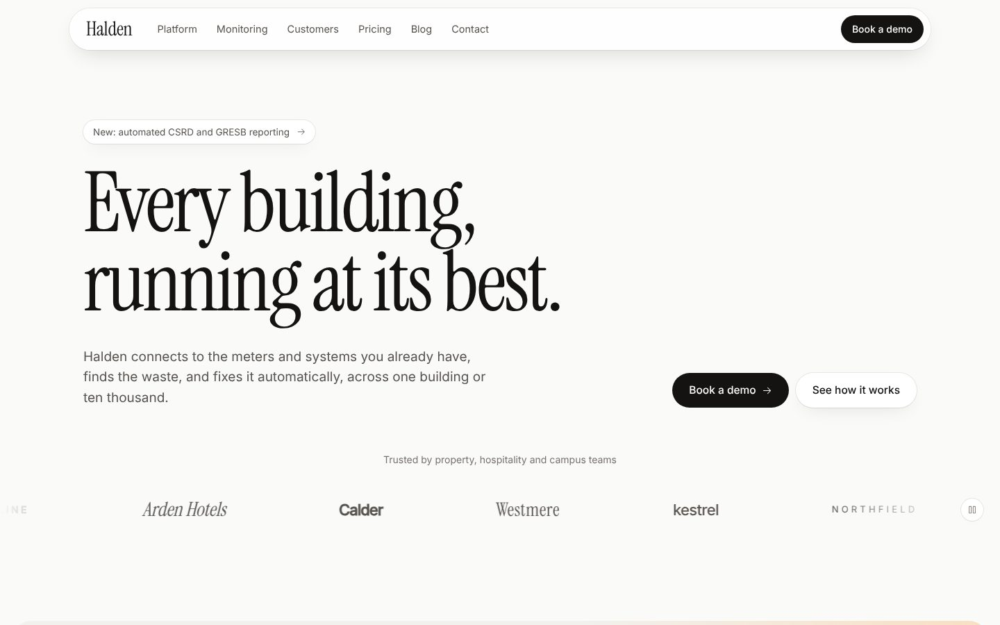
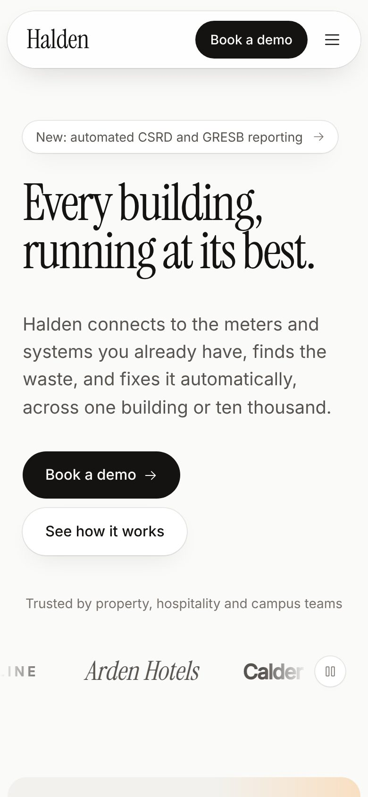
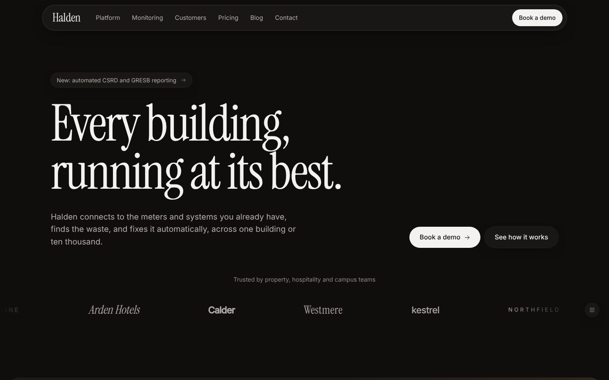
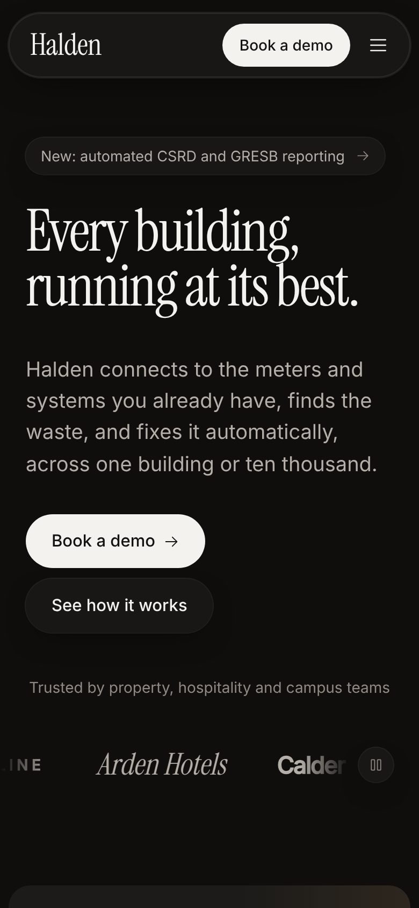
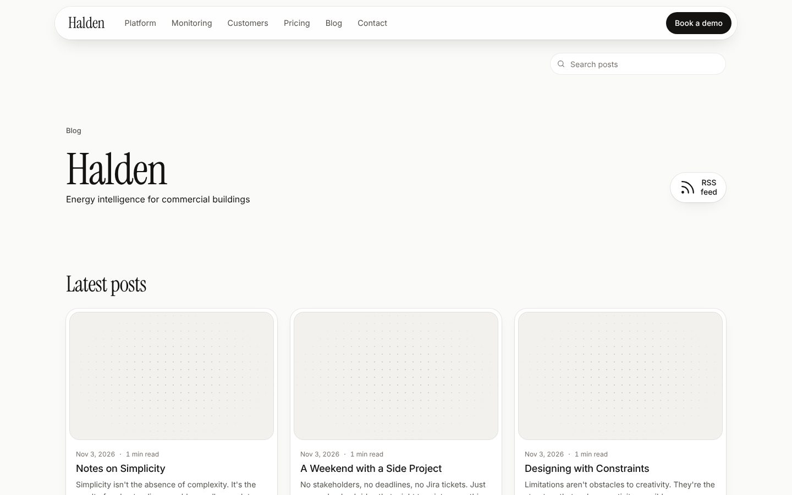
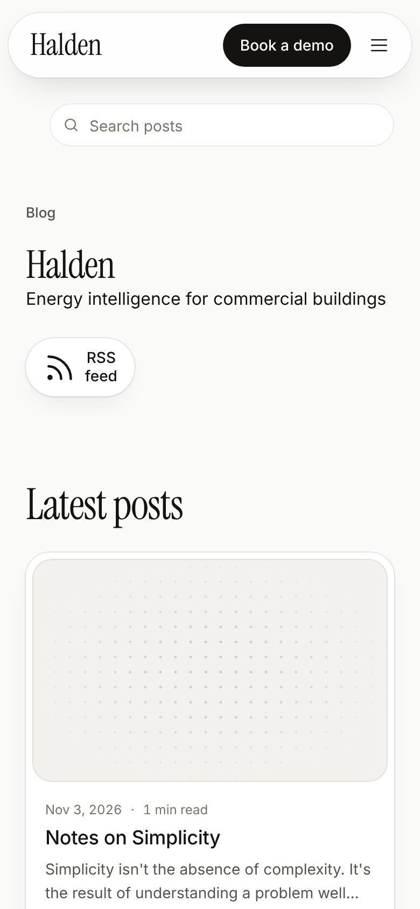
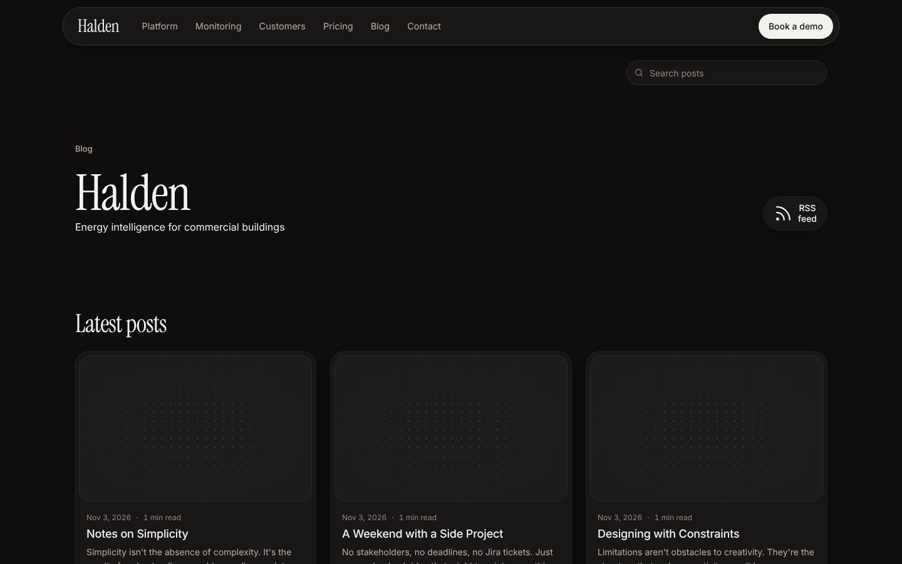
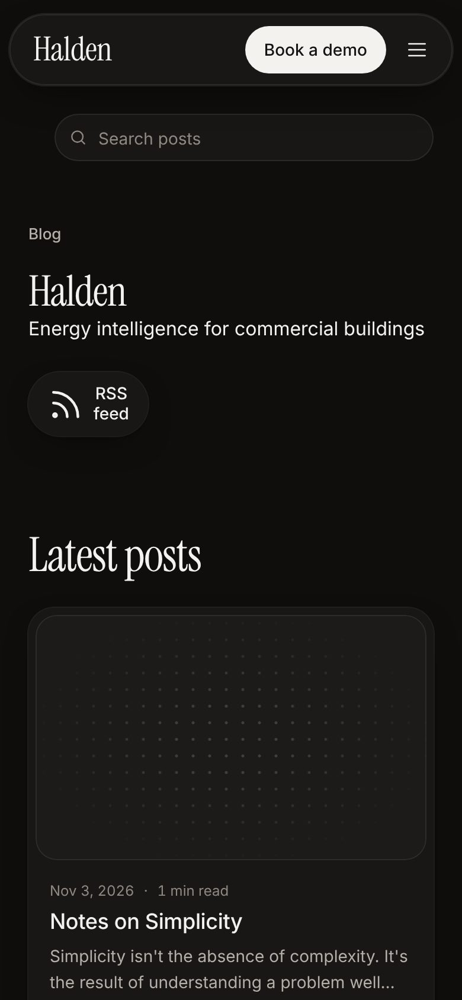
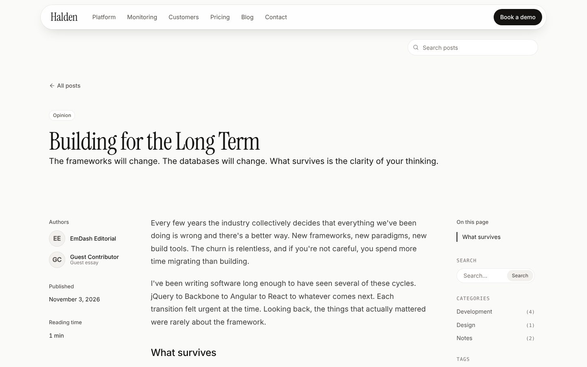
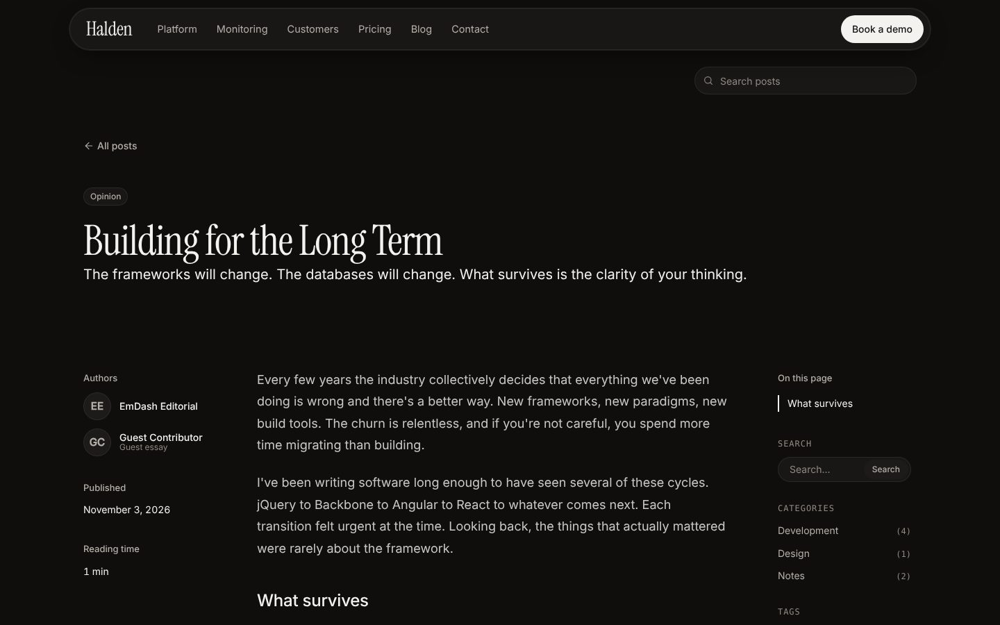

# EmDash Marketing + Blog Starter (Cloudflare)

A starter that combines two official [EmDash](https://github.com/emdash-cms/emdash) templates: the **marketing** site (landing page built from modular content blocks) and the **blog** (posts, categories, tags, search, RSS, bylines, comments, sidebar widgets). The blog lives under `/blog`, so the marketing pages keep the root. Both share one design system, so restyling happens in one place.

It runs on Cloudflare Workers with D1, R2 and KV, and stays a starter: demo content you replace, no extra features.

[](https://deploy.workers.cloudflare.com/?url=https://github.com/hyasynth-ai/emdash-cms-template)

## What's included

**Marketing** (from the marketing template): hero, logo wall, features, text and image, stats, testimonials, pricing, FAQ, call to action, contact options, SEO metadata and JSON-LD, dark/light/system theme.

**Blog** (from the blog template): post index and archive, post pages with table of contents, categories, tags, live search, RSS, bylines, comments (built in, off by default: set `commentsEnabled` on the `posts` collection), sidebar widgets (categories, tags, recent posts, archives).

## Screenshots

| | Desktop | Mobile |
|---|---|---|
| Marketing, light |  |  |
| Marketing, dark |  |  |
| Blog, light |  |  |
| Blog, dark |  |  |
| Post, light / dark |  |  |

## Routes

| Route | What it shows |
|---|---|
| `/`, `/pricing`, `/contact`, `/{slug}` | Marketing pages (the `pages` collection) |
| `/blog` | Blog home: featured post and latest posts |
| `/blog/all` | All posts, paginated |
| `/blog/{slug}` | A post |
| `/blog/category/{slug}` | Posts in a category |
| `/blog/tag/{slug}` | Posts with a tag |
| `/blog/search?q=` | Search results (the search bar is on every blog page, not in the site header) |
| `/rss.xml` | RSS feed |
| `/category/{slug}`, `/tag/{slug}`, `/search` | 301 redirects into `/blog/...`. EmDash's built-in sidebar widgets link to these fixed paths. |

Avoid the post slugs `all`, `search`, `category` and `tag`: they match blog routes.

## How it differs from the upstream templates

- The blog is under `/blog` instead of the site root. Categories, tags and search moved with it.
- One layout: blog pages render inside the marketing `Base.astro` through `BlogLayout.astro`, so the header, footer, menus and theme switch are shared.
- One design system: blog styles use the marketing tokens (see below). The blog has no tokens of its own.
- Search appears on blog pages only.
- Dependency versions are pinned exactly (see `package.json` and `pnpm-lock.yaml`).

## Restyling

All visual decisions live in the marketing design tokens.

1. Override tokens in `src/styles/theme.css` (colours, fonts, radii, spacing, sizes). Don't edit `tokens.css` or `Base.astro` for looks. Colours use `light-dark()`, so one override covers light and dark.
2. `src/styles/blog.css` is the only blog stylesheet. It is scoped to `.blog-page`, contains blog-specific layout, and begins with a small bridge that maps variables the blog needs onto marketing tokens (for example `--color-fill` to `--color-sunken`). Change a marketing token and the blog follows.
3. Blog headings use `--font-display`, container and gutters use `--wide-width` and `--gutter`, buttons use the marketing `.btn` classes.

Webfonts are set in `astro.config.mjs` under `fonts:`. See `AGENTS.md` for the full list of tokens and shared classes.

## Local development

```bash
pnpm install
pnpm dev
```

Open http://localhost:4321/_emdash/admin and complete the setup wizard. EmDash runs migrations and applies `seed/seed.json` (marketing pages, blog collection, 8 sample posts) during setup. The site is at http://localhost:4321.

Sample post images are fetched from Unsplash when the seed is applied, so the first setup needs internet access.

## Deploying

```bash
pnpm wrangler login
pnpm deploy
```

The first deployment provisions the D1 database, R2 bucket and KV namespace named in `wrangler.jsonc`. Complete the setup wizard at `/_emdash/admin` on the deployed URL; the seed is applied then, on an empty database only. See [Deploy to Cloudflare](https://docs.emdashcms.com/deployment/cloudflare/), or use the button above.

### Starting your own site from this template

Use GitHub's "Use this template" button, then in your new repo:

1. In `wrangler.jsonc`, set `name`, the D1 `database_name` and the R2 `bucket_name` to your own names. Cloudflare resource names are lowercase letters, numbers and dashes, so `example.com` becomes `example-com`.
2. In `package.json`, set `name`, `description` and `repository`.
3. Create the Cloudflare project with the same name as `name` in `wrangler.jsonc` and deploy.
4. After the setup wizard, replace the Halden demo content: site title and tagline, pages, posts, menus, and photos.
5. Keep `LICENSE` as is and add your own copyright line under the existing ones.

### Preview deploys

Non-production branches don't auto-provision bindings, so a preview build fails with `binding SESSION of type kv_namespace must have a namespace_id specified [code: 10021]`. After the first production deploy, copy the D1 and KV ids from the Cloudflare dashboard into the commented `previews` block in `wrangler.jsonc` and uncomment it. A preview that uses those ids reads and writes the same data as production.

### Troubleshooting: "Database migrations are required"

A 503 reading `Database migrations are required. Apply the deployment migration manifest and retry.` means EmDash could not finish its database migrations during a request. Two causes to check:

- **Workers Free plan.** D1 allows 50 queries per Worker invocation on Free (1000 on Paid), and the first request runs every migration. If it runs out, it stops partway and can leave the migration lock held. Use the Workers Paid plan, or apply migrations from your machine as below.
- **Held lock.** A first request that was interrupted (a deploy, a timeout, or the cron trigger racing the first visit) can leave the lock held. EmDash stops retrying and waits for a person to release it.

Apply or inspect migrations from your machine instead of the Worker. You need the account id and a Cloudflare login (`pnpm wrangler login`, or an API token with D1 edit rights in `CLOUDFLARE_API_TOKEN`; I have not tested a token-only run):

```bash
pnpm migrate:status --account-id <account id>          # lists pending migrations and shows the lock id, if held
pnpm migrate --account-id <account id>                 # applies pending migrations
pnpm migrate --account-id <account id> --release-lock <lock id>   # only when no migration is running
pnpm migrate --account-id <account id> --take-over-lock <lock id> # releases the lock and applies in one step
```

Add `--d1 <name or id>` if the database name in `wrangler.jsonc` doesn't resolve on its own. If a deploy leaves the database half-migrated, the clean fix is to delete the D1 database and redeploy (see Tearing down).

### Tearing down

To delete everything a deployment created (use the dashboard, or wrangler):

```bash
pnpm wrangler delete --name my-marketing-blog-site
pnpm wrangler d1 delete my-marketing-blog-site
pnpm wrangler r2 bucket delete my-marketing-blog-media    # must be empty: delete its objects first
pnpm wrangler kv namespace list                            # find the SESSION namespace id
pnpm wrangler kv namespace delete --namespace-id <id>
```

Redeploying afterwards starts from an empty database and re-applies the seed at setup.

## Removing the blog

If you only want the marketing site:

1. Delete `src/pages/blog/`, `src/pages/category/`, `src/pages/tag/`, `src/pages/search.ts`, `src/pages/rss.xml.ts`, `src/layouts/BlogLayout.astro`, `src/styles/blog.css`, `src/styles/prose.css`, and the blog-only components and utils (`PostCard`, `Byline`, `Pagination`, `utils/locale.ts`, `utils/reading-time.ts`, `utils/site-identity.ts`).
2. In `seed/seed.json`, remove the `posts` collection, the `category` and `tag` taxonomies, `bylines`, `sections`, the `sidebar` widget area, the `posts` entries under `content`, and the "Blog" menu item.
3. Run `pnpm exec astro check` and `pnpm build`. Optionally run `npx emdash types` to drop the `posts` types from `emdash-env.d.ts`.

This path was tested: the marketing pages build and serve with the blog removed.

## License

MIT. Derived from the EmDash marketing and blog templates (Copyright 2026 Cloudflare Inc.). See `LICENSE`.
